# tdeck: a custom firmware for the LilyGO T-Deck Plus

A from-scratch firmware for the T-Deck Plus, the pocket ESP32-S3 device with a 2.8" screen,
a BlackBerry-style keyboard, a trackball, LoRa, WiFi, Bluetooth, GPS and a microSD slot. It
stays compatible with Meshtastic on the US LongFast channel, so it chats with stock nodes,
and it adds the things a pocket deck should do: radio scanners, GPS tools, notes, music, and
a second life as a wireless keyboard and mouse through a USB dongle.

The look is a black screen with phosphor green text, after the cmatrix terminal screensaver.

Screenshots are in [`screenshots/`](screenshots/), captured from the device over its serial
console (T-Deck, 320×240) and from the dongle over USB (GEEK, 240×135, shown at 2×).

## What it does

### Mesh

- **Chat** on the LongFast channel plus direct messages. Each message shows its delivery
  state: queued, sent, relayed or acknowledged, failed. Direct messages use Meshtastic's
  public-key encryption (X25519 and AES-256-CCM), which Meshtastic 2.7 requires. A tone
  plays for a new message when the chat is not on screen.
- **Nodes** lists every node heard with name, last heard, hops, signal, battery, distance
  and bearing. From a node: message it, ask for its position or info, show it on the map.
- **Map** draws offline tiles from the SD card in the same layout Meshtastic's own UI uses,
  or a distance grid without tiles, with every node that has a position.
- **Relaying** of other nodes' packets, with counts in Settings. Confirmed against two stock
  nodes.

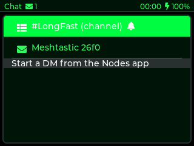 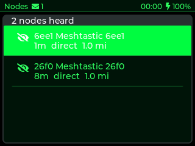 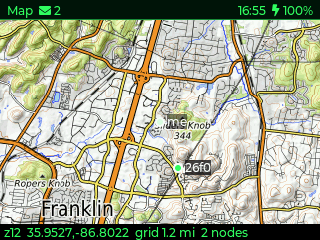 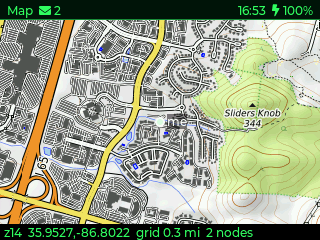

### Radio tools

- **WiFi** scanner: network name, signal, channel, security, hardware address, and a count
  of networks per channel.
- **BLE** scanner that flags item trackers (Apple Find My and AirTag, Tile, Samsung
  SmartTag, Google Find) and Meshtastic devices.
- **Spectrum**: three waterfalls. LoRa sweeps 902 to 928 MHz with an automatic noise floor.
  WiFi hops channels 1 to 13 in promiscuous mode and draws each channel's 22 MHz hump. BLE
  gives each nearby device its own lane, trackers in amber.

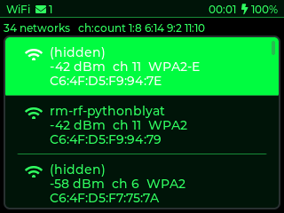 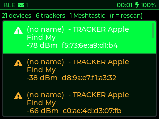 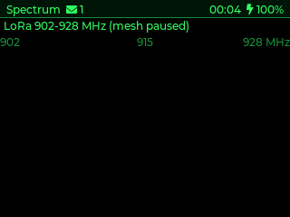

### Position

- **GPS** auto-detects the module (Quectel L76K or u-blox M10), shows fix, satellites,
  HDOP, position, altitude, speed and UTC, and sets the clock. Sharing your position on the
  mesh is a switch, off by default.
- **Compass** is a heading-up rose from the GPS course, with speed, altitude and a trip
  counter (distance, moving time, top speed) that keeps counting with the app closed, and a
  waypoint that survives reboots. The T-Deck Plus has no magnetometer, so the heading comes
  from motion.

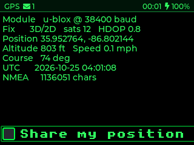 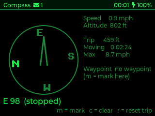

### Keyboard and mouse for the computer

The **Keyboard** app turns the T-Deck into a wireless keyboard and trackball mouse, two ways:

- **Bluetooth**: pair "T-Deck Keyboard" from a computer or phone, no PIN.
- **USB dongle**: a Waveshare ESP32-S3-GEEK (or any ESP32-S3/S2) plugs into the computer
  and types what the T-Deck sends over ESP-NOW. Pairing is an X25519 key exchange; every
  packet after that is AES-CCM encrypted and carries an HMAC tag and a counter, so a
  recorded packet cannot be replayed. Keys travel as press-and-release taps, so a lost
  packet never leaves a key stuck down.

The trackball is a mouse with a speed curve (slow rolls move a few pixels, flicks move far),
a double-click for scroll mode, and a press-release-press-and-hold for drag. The GEEK's
little screen shows the link state and the last keys typed.

The same link carries more than keystrokes:

- **Mesh on the desk**: with "Mesh: To dongle" on, every chat message is relayed to the
  dongle's USB serial port as JSON, and lines typed there go out on the mesh. A small
  script makes the computer a Meshtastic terminal with no app. Messages that arrive while
  the dongle is unplugged are forwarded when it returns, capped at the last 20.
- **Shared drive**: the GEEK's TF card is a USB drive on the computer and a folder on the
  T-Deck at the same time. Notes sync to it, the to-do list syncs both ways, music pulls
  from it, and the Files app browses it over the air.

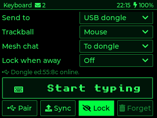 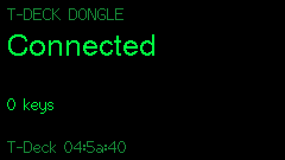

### Everyday

- **Notes**: plain text files on the SD card, edited on the device.
- **To-do**: a check list kept in a text file, synced with the computer through the dongle.
  Deleting a line on either side sticks.
- **Files**: SD browser with sizes and free space, text viewer, push and pull to the dongle.
- **Timer**: stopwatch with laps and a countdown that rings the speaker and wakes the screen
  from any app.
- **Music**: MP3 and WAV from the SD card through the speaker, folders as playlists, keeps
  playing with the app closed.
- **Settings**: names, modem preset, channel, transmit power, hop limit, relaying, position
  precision, brightness, screen timeout, time zone, message tone, radio statistics.

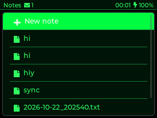 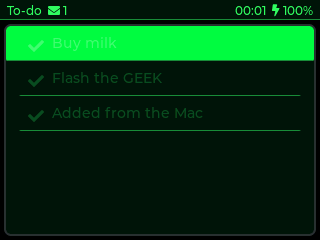 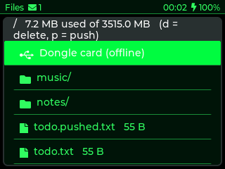
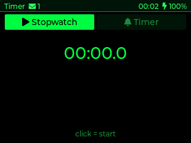 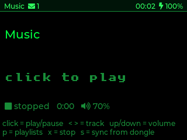 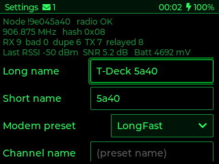

### Living in a pocket

The screen fades after 10 seconds and locks, so keys pressed in a pocket do nothing. Holding
the trackball for a second unlocks it; holding it for two seconds locks it on purpose. Every
app is driven by the keyboard and trackball; the touch screen works too, except in the
Keyboard app where a thumb would hit it.

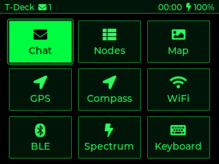 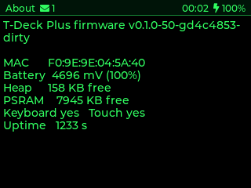

## How it is built

- ESP32-S3 with the Arduino core on PlatformIO, C++.
- LVGL 8 for the UI, TFT_eSPI for the ST7789 panel, RadioLib for the SX1262 LoRa radio,
  NimBLE for Bluetooth, ESP8266Audio for playback, TinyUSB on the dongle for keyboard,
  mouse, serial and mass storage at once.
- Meshtastic protocol implemented directly: protobuf framing, channel hashing, AES-CTR
  channel encryption, PKI direct messages, NodeInfo, position and routing, all without the
  Meshtastic firmware tree.
- A serial console on the USB port drives every app and takes screenshots, so the device
  can be exercised and photographed from a script. The dongle answers the same way.
- One issue, one pull request, one review and one squash commit per change, from the first
  version on.

## Hard problems along the way

- **Stale bands on the screen on first open.** The display and the SD card share one SPI
  bus; the panel wants SPI mode 3 and the card mode 0, and on the S3 the mode change
  reached the clock line after the panel's chip select was already low, so the panel
  dropped the first block of every flush after a card access. Fix: one dummy byte in mode
  3 with every chip select high before each flush.
- **Lists that drifted apart.** The SD card does not mount on every boot, so apps wrote to
  internal flash on those boots and showed the stale card copy on the next. Fix: load both
  copies, merge, and retire the flash copy once the card holds the result.
- **Scrolling with a trackball.** Holding the button while rolling does not work, the ball
  barely turns pressed in, and the keyboard reports no modifier keys. Fix: a double-click
  toggles a scroll mode and a single click ends it.
- **Dongle identity.** The Arduino core starts USB before `setup()` when the serial console
  is on at boot, so a custom USB name and product id were ignored. Fix: start USB from
  `setup()` after setting them.
